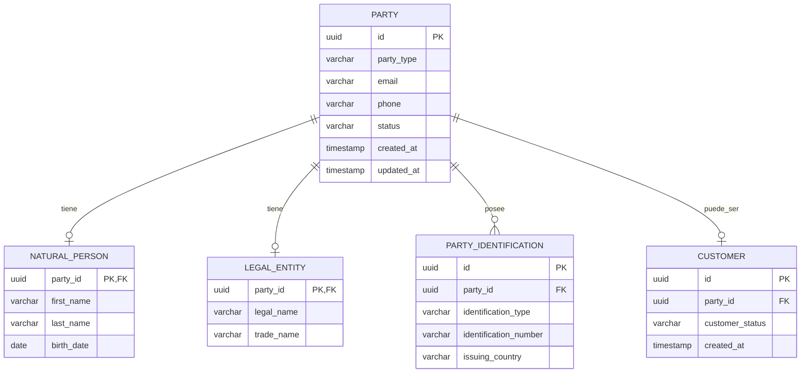

# Diagrama Entidad-Relación - Módulo Clientes

**Proyecto:** Insurance Core  
**Documento:** BD-002  
**Versión:** 1.0  
**Estado:** Propuesta inicial

## 1. Diagrama

## 2. Descripción de las relaciones

- PARTY y NATURAL_PERSON: una persona puede tener información específica de persona física.
- PARTY y LEGAL_ENTITY: una persona puede tener información específica de persona jurídica.
- PARTY y PARTY_IDENTIFICATION: una persona puede tener varias identificaciones.
- PARTY y CUSTOMER: una persona puede tener una relación comercial como cliente.

## 3. Consideraciones

- Los identificadores principales serán UUID.
- Las relaciones se implementarán mediante claves foráneas.
- Una persona física no deberá tener simultáneamente un registro de persona jurídica.
- La obligatoriedad de las entidades específicas se garantizará mediante validaciones y restricciones.
- La unicidad de identificaciones deberá contemplar su tipo y ámbito de emisión.

## 4. Observación

El diagrama representa el diseño inicial. Las restricciones definitivas se especificarán durante el diseño físico de PostgreSQL.
